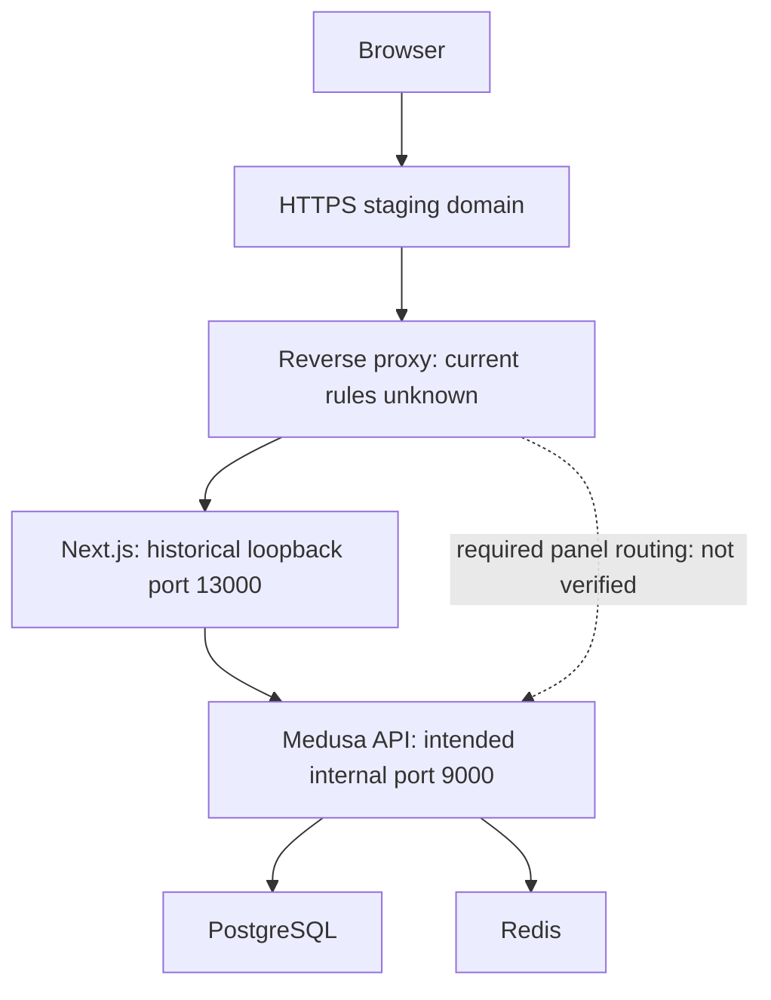

# DIDAR Server Deployment Status

Assessment date: 2026-10-17 (Asia/Tehran). Read-only observations collected in this assessment; source snapshot pinned below.

**Status: PARTIAL READ-ONLY ASSESSMENT — PUBLIC NATIVE PANEL ROUTING FAILURE CONFIRMED; CURRENT HOST STATE AND DEPLOYED SHA UNVERIFIED.**

Scope: STAGING / PREVIEW only. Prepared for Chief Architect review alongside the [Mercur/Medusa core review](mercur-medusa-core-review-2026-10-17.md). This report authorizes no implementation, infrastructure change, release promotion or architecture decision.

## 1. Executive summary

- The public HTTPS storefront at [darlingbebe.shop](https://darlingbebe.shop/) renders a Persian customer application and explicitly labels payments as experimental.
- Both [Admin /dashboard](https://darlingbebe.shop/dashboard) and [Vendor /seller](https://darlingbebe.shop/seller) render the **customer storefront shell with “صفحه پیدا نشد” (page not found)**. Neither native authentication screen nor native workspace is publicly verified at these required URLs.
- [Legacy /manage](https://darlingbebe.shop/manage) is reachable but presents an anonymous sign-in gate within the customer shell. It is not evidence of native Mercur Admin availability and must not be represented as the final back office.
- Catalog reads settle successfully to **zero publicly visible products**; cart and checkout settle to empty-cart states. A published product, merchant context, populated checkout and role-authorized navigation could not be exercised without appropriate test identities and data. Zero visible products does not prove an empty database.
- GitHub main was independently resolved to **`bdf4b813626261225425c79ffb566ac3e5e05fd6`**. The most recent implementation commit before two subsequent documentation commits is native recovery **`0aeec24d2292fb3e60848ac2deaa68b76a478ded`**. Repository receipts report native engineering tests, not this server's runtime.
- **Actual deployed SHA, container image provenance, database/Redis health, installed migrations and application startup logs remain unknown.** The SSH transport returned `Network is unreachable` before authentication. The provider session opened a sign-in form, so no fresh provider data was collected.
- No server, DNS, certificate, firewall, container, configuration, identity, database, application code or existing deployment was changed. No checkout, account creation or business mutation was submitted.

## 2. Server topology

### Evidence levels

**LIVE** means observed in this assessment's browser/connector/transport. **HISTORICAL** means a prior owner terminal receipt or provider inspection in the project conversation. **SOURCE** means inspected repository configuration; it is not proof of the installed configuration. **UNKNOWN** means unverified.

| Component | Evidence | Assessment |
| --- | --- | --- |
| Provider / server label | HISTORICAL | ParsPack IaaS, `didar-dev-01`, Frankfurt |
| OS / architecture | HISTORICAL | Debian GNU/Linux 13 (trixie); x86_64 selected at provisioning. Current kernel/package inventory not obtained |
| Resources | HISTORICAL | 4 vCPU, 8 GB RAM, 100 GB disk. Current free disk, memory pressure and CPU utilization unknown |
| Public entry | LIVE | HTTPS domain renders the customer Next.js interface without a browser certificate interstitial |
| Reverse proxy | HISTORICAL / INFERENCE | Nginx domain configuration was supplied in this workstream. Current public behavior is consistent with all paths reaching Next.js; active Nginx configuration has not been read |
| Storefront listener | HISTORICAL | Owner's `ss` output showed `127.0.0.1:13000`; intended container port 3000 |
| Medusa API / native panels | HISTORICAL + SOURCE | Owner's `ss` output showed `127.0.0.1:19000`; intended container port 9000 |
| PostgreSQL / Redis | SOURCE | Separate containers and persistent volumes in staging Compose; no host ports declared. Current listeners, connectivity, health and versions unknown |
| Host development tools | HISTORICAL | Owner reported Node 20.19.2, npm 9.2.0 and Git 2.47.3 after installation |
| Application container toolchain | SOURCE | Staging wrapper specifies Node 24.19.0 and Bun 1.4.3; actual running image versions not inspected |

Historical/intended path:

The diagram describes intended/historical topology, not a current container inventory. Native panel/API routing must be reviewed as one configuration, including their assets and authentication endpoints; proxying the two panel HTML paths alone is not sufficient evidence.

### Services and persistence defined in the separate staging kit

The inspected `staging/debian13-phase2-00447d3` kit defines `postgres`, `redis`, one-shot `migrate`, `api`, and `storefront`. It declares PostgreSQL 17-alpine, Redis 7-alpine and persistent `postgres`, `redis`, `uploads` volumes. This is **source inventory only**. No current `docker ps`, inspect result or restart history was available.

The updater uses explicit application SHAs, archives a release, builds before stopping apps, then backs up database/uploads/configuration, runs migrations/seed, performs health checks and changes the `current` symlink after success. These are inspected script behaviors, not a fresh backup/restore verification.

## 3. Running applications and exact URLs

All listed public URLs were opened in the live browser. “Not found” below is the rendered application result; an HTTP status code was not independently captured.

| Application / URL | LIVE anonymous result | Authentication / navigation boundary |
| --- | --- | --- |
| Customer home — https://darlingbebe.shop/ | Persian styled customer home, sandbox banner and catalog UI | Home → products and cart links respond |
| Catalog — https://darlingbebe.shop/products | Catalog UI, discovery links and filters; zero visible products | No published PDP available to test |
| Cart — https://darlingbebe.shop/cart | “سبد شما خالی است” | No cart writes performed |
| Checkout — https://darlingbebe.shop/checkout | “ثبت سفارش”, then empty-cart message | No purchase, reservation or payment attempted |
| Customer account — https://darlingbebe.shop/account | Sign-in-required screen | Anonymous gate observed; actual authorization after login untested |
| Customer login — https://darlingbebe.shop/login | Email/password fields and membership button in customer shell | No credentials entered, invalid login attempts or registration submitted |
| Native DIDAR ADMIN — https://darlingbebe.shop/dashboard | Customer shell + “صفحه پیدا نشد” | Native Admin login and functional navigation unavailable at public entry |
| Native MERCHANT/VENDOR — https://darlingbebe.shop/seller | Customer shell + “صفحه پیدا نشد” | Native Vendor login, store selector and own-merchant navigation unavailable at public entry |
| Legacy management — https://darlingbebe.shop/manage | Customer shell + sign-in-required screen | Transition surface only; no privileged session tested |

Historical tunnel targets `http://localhost:19000/dashboard` and `http://localhost:19000/seller` are **not verified running URLs in this assessment**. Browser access to this cloud environment's localhost would not test the owner's SSH tunnel.

## 4. GitHub main SHA versus deployed SHA

| Reference | Exact SHA / result | Evidence |
| --- | --- | --- |
| main at assessment start | `bdf4b813626261225425c79ffb566ac3e5e05fd6` | LIVE GitHub commit resolution; ADR draft documentation commit |
| Latest implementation checkpoint preceding docs | `0aeec24d2292fb3e60848ac2deaa68b76a478ded` | LIVE repository history; native recovery implementation |
| Previous Phase 4 candidate | `993cb21f25a5926d85448e0d7e496e8f04cbb8ef` | Previously recommended update target, not a confirmed deployment |
| Last deployment success receipt provided by owner | `00447d39ffa64881c35813b5242b95fd356c84bb` | HISTORICAL `Healthy staging application commit` output in this workstream |
| Actual currently deployed/running SHA | **UNKNOWN** | No live release marker, image IDs or container build identity obtained |
| Frontend/backend SHA consistency | **UNKNOWN** | No per-image/container provenance obtained |
| Release currency | **UNVERIFIED** | Public routing demonstrably fails the native-panel acceptance requirement, but this alone cannot date the installed source |

GitHub comparison confirms main is eight commits ahead of the historical Phase 2 receipt and six ahead of the proposed Phase 4 candidate. **These are comparisons of known Git refs, not measured deployment lag.** No assertion that the server is exactly eight or six commits behind is made.

Source now contains native SDK routes/navigation, shared UI package integration, identity/seller linking and native product guards that did not exist in the historical Phase 2 snapshot. Their presence in GitHub does not prove image rebuild, migration execution or live deployment.

### Verification receipts versus independently verified runtime

The native recovery receipt reports 166 backend tests / 2,107 assertions, one native HTTP suite and 24 production browser tests, with four builds and synthetic native Admin/Vendor/customer journeys. These are **repository-reported engineering results**, not independently rerun tests and not staging acceptance. The receipt includes source/output hashes; this assessment did not reproduce that build.

A current public rendered page or hashed Next asset URL cannot establish a full Git SHA. To close the gap, correlate the release marker, actual API/storefront image IDs and image build/release metadata from the host.

## 5. Native Admin / Vendor / Customer availability

- **Admin: PUBLIC ENTRY FAIL.** Actual rendered response is the Next.js customer not-found page. Whether the backend serves valid Admin assets on the internal port remains unknown.
- **Vendor: PUBLIC ENTRY FAIL.** Same result; native seller authentication and tenant store selection were not reached.
- **Customer: PARTIAL PASS.** Home/catalog/cart/account/login/empty checkout rendered and basic link navigation worked. Populated catalog, actual login, order history, merchant-specific shop and complete sandbox checkout are unverified.
- **Legacy management: ANONYMOUS GATE OBSERVED.** This does not satisfy native panel recovery or establish complete role enforcement.
- **Tenant isolation: NOT TESTED LIVE.** No authorized merchant A/B or central Admin sessions were available to this assessment. Repository tests are not a substitute.
- **Desktop visual evidence:** A 1363×936 browser visually showed styled customer branding on the supposed Admin route, with its central not-found message. No claim of globally missing CSS is made.
- **Screenshots / mobile:** No authenticated interface screenshot set was produced; no account/customer/financial content was captured. No supported mobile-viewport assessment was performed in this session. Repository screenshots remain development evidence, not screenshots of this deployment.

## 6. Confirmed deployment and UI problems

| ID | Priority | Finding and evidence | Boundary / implication |
| --- | --- | --- | --- |
| DEP-01 | High | Both required public native panel paths render the storefront not-found interface | Public routing/availability failure confirmed. Wrong upstream or incomplete routing is a leading hypothesis; internal panel build failure remains possible |
| DEP-02 | High | No live running commit or per-service provenance could be obtained | Release currency and frontend/backend compatibility cannot be certified |
| DEP-03 | Medium | No public products available to this anonymous session | Blocks meaningful PDP/stock/quote/checkout acceptance. Could be intentional unpublished staging data; not classified as data loss or API failure |
| DEP-04 | Medium | `/manage` remains a separately reachable customer-shell management entry | Transitional legacy surface confirmed. Native parity/cutover must follow governance; do not delete or redirect blindly |
| DEP-05 | High, conditional | Original staging kit uses localhost native-panel build origin/CORS/file URLs and only exposes loopback listeners | If retained during public rollout, panels may call the operator's own localhost and native images/login may fail. Current installed values not inspected |
| DEP-06 | High, source-confirmed deployment risk | Core audit reports non-demo seed returning before native identity-link schema; inspected source has the early return before the trailing `native-schema.sql` execution | Native identity readiness cannot be assumed from successful old updater/health checks. Not a claim that a live table is missing |
| DEP-07 | Medium, conditional | Phase 4 video requires FFmpeg/FFprobe; old staging wrapper and original proxy upload/time limits need reconciliation with newer media limits | A local wrapper patch was previously suggested but no final host output proves it exists. Main Dockerfile support alone does not update a separate kit |
| DEP-08 | Medium | Native authentication, delegated staff, membership and tenant checks could not be exercised | No live isolation/security signoff; no auth bypass was observed or attempted |

Startup first-load “receiving products/account/cart” states settled on subsequent observation; they are not reported as permanent loading failures.

Browser console sampling showed browser-extension metadata errors; they are not attributed to the application. Application container startup warnings/errors and server access logs were unavailable. Individual native panel JS/CSS URLs could not be tested because native HTML was never served at the public entries. No product media were available for a broken-image audit.

## 7. Security and operational risks

1. **Wrong application origin and route ownership:** Preserve the native `/dashboard` Admin and `/seller` Vendor distinction. Verify native auth/API routes and built asset bases together. Do not spoof authentication headers or remove origin checks to make a page load.
2. **Unverified identity/migration readiness:** A reachable customer login is not proof of native actor links, seller membership or fine-grained permissions. The source audit's installer-path defect needs review before relying on a routine migration for native rollout.
3. **Staging exposure:** Public pages display sandbox labels, but installed payment/demo flags and disabled real-provider configuration were not inspected. A banner is not proof of backend sandbox enforcement.
4. **Data services and backups:** Current PostgreSQL/Redis listener isolation, health, persistence, last successful backup, restoration and disk headroom are unknown. No sensitive DB records were queried.
5. **Access hygiene:** A server credential appeared earlier in the workstream. It is intentionally excluded here and should be treated as exposed; arrange owner-controlled rotation through the approved procedure. No credential is reused, printed, changed or placed in this PR.
6. **TLS:** HTTPS pages rendered without an interstitial; certificate issuer/expiry, HTTP→HTTPS policy, renewal timer and external reachability from other networks were not established.
7. **One API replica:** Inspected deployment guidance uses one API replica with existing provider behavior. Do not scale or change infrastructure based on this partial assessment.
8. **Independent test data:** Do not run destructive fixture/E2E seeding against this persistent staging database merely to populate the catalog. Use explicitly approved synthetic test records through normal workflows or an isolated disposable test environment.

## 8. Recommended corrections

Recommendations only; no corrections were executed.

1. Obtain a fresh, sanitized host evidence bundle. Record release marker and per-service image IDs, uptime/health/restarts, listener bindings, resource pressure, PostgreSQL connectivity and Redis PING, migration history and relevant error excerpts.
2. Reconcile that deployed SHA against a Chief-Architect-approved candidate; do not deploy moving main or interpret documentation commits as a verified new application release.
3. Review DEP-06 with the Core Architect and test the normal non-demo installer/migration path before native rollout. Preserve existing data and immutable links/history.
4. Prepare the smallest reviewed reverse-proxy/native asset/auth/API routing correction, including public or same-origin panel build configuration and actual file URLs. Keep data services private and payment providers sandboxed.
5. Reconcile the staging wrapper with candidate runtime requirements, shared UI package builds, FFmpeg/FFprobe, request limits and health checks. Test image build and migration on an isolated copy before changing staging.
6. After explicit authorization, verify authentic native Admin login/sidebar, Vendor login/store selector/own-only data, and customer browsing/checkout. Include cross-merchant read-only checks and sanitized desktop/390px screenshots.
7. Only retire legacy `/manage` entry points after role/deep-link parity, identity mapping and audit review. Preserve the existing working operational path during cutover.

## 9. Evidence and verification limitations

### Evidence register

| ID | Source | What it establishes |
| --- | --- | --- |
| LIVE-01 | Browser GET/navigation: public home, products, cart, checkout, account, login, manage | Actual anonymous rendered customer UI and settled empty states |
| LIVE-02 | Browser GET: public dashboard and seller | Both paths render customer not-found screen; desktop visual check |
| LIVE-03 | GitHub main resolution/history/compare at assessment time | Pinned SHA and ancestry counts above |
| BLOCK-01 | One read-only SSH transport attempt | `Network is unreachable` before authentication; no host command executed |
| BLOCK-02 | Provider overview navigation | Existing provider session requires sign-in; no fresh server inventory |
| HIST-01 | Earlier provider inspection and owner OS/tool/listener outputs in this workstream | Historical resource/OS/loopback-port facts, not current host state |
| HIST-02 | Owner's Phase 2 successful updater receipt | Historical application SHA only; no current container identity |
| SRC-01 | [Medusa config](https://github.com/alirezasefidpour747/didar-b2c-marketplace/blob/bdf4b813626261225425c79ffb566ac3e5e05fd6/packages/api/medusa-config.ts) | Native Admin/Vendor route ownership, CORS/environment use and file backend origin |
| SRC-02 | [Native recovery evidence](https://github.com/alirezasefidpour747/didar-b2c-marketplace/blob/bdf4b813626261225425c79ffb566ac3e5e05fd6/verification/mercur-native/RESULTS.md) | Reported engineering checkpoint, not live server verification |
| SRC-03 | [Architecture directive](https://github.com/alirezasefidpour747/didar-b2c-marketplace/blob/bdf4b813626261225425c79ffb566ac3e5e05fd6/docs/MERCUR_NATIVE_PANEL_ARCHITECTURE.md) | Native-first requirement and transition restrictions |
| SRC-04 | [Core audit review](https://github.com/alirezasefidpour747/didar-b2c-marketplace/blob/bdf4b813626261225425c79ffb566ac3e5e05fd6/docs/audits/mercur-medusa-core-review-2026-10-17.md) and [seed source](https://github.com/alirezasefidpour747/didar-b2c-marketplace/blob/bdf4b813626261225425c79ffb566ac3e5e05fd6/packages/api/src/scripts/didar-seed.ts) | Non-demo native-link migration risk and unresolved architectural decisions |
| SRC-05 | [Separate staging kit](https://github.com/alirezasefidpour747/didar-b2c-marketplace/tree/staging/debian13-phase2-00447d3/deploy/debian13) | Inspected intended service/runtime/update configuration, not current installed files |
| SRC-06 | [Native recovery implementation](https://github.com/alirezasefidpour747/didar-b2c-marketplace/blob/bdf4b813626261225425c79ffb566ac3e5e05fd6/docs/MERCUR_NATIVE_RECOVERY_IMPLEMENTATION.md) | Native identities, same-origin option and documented parity limits |

Search-service page retrieval could not access the domain, while the separately authorized direct browser inspection succeeded. Neither search retrieval failure nor the SSH environment's egress failure is classified as staging downtime or a site bot block.

### Remaining read-only host checks

An authorized server operator should collect these without altering the deployment:

- OS/kernel/architecture and CPU/memory/disk headroom.
- Current release `DEPLOYED_COMMIT`, API/storefront image IDs and build identities; verify those running IDs correspond to the release marker.
- Docker service status, health, restart counts, dependency connectivity, exact listeners and mounted persistence locations. Inspect selected fields only; do not dump container environment variables.
- Targeted Nginx route and public-header settings, certificate dates and renewal state; redact private configuration details before sharing.
- PostgreSQL readiness plus a harmless connectivity check and Redis PING; inspect additive migration/native-link table presence without disclosing rows.
- Locally inspect startup/error logs and submit only sanitized, relevant excerpts. Do not publish raw logs, full `docker inspect`, full Compose configuration, private env files, DB dumps, tokens or records.
- Read-only internal panel HTML/asset checks and frontend/backend version matching; no account provisioning or password changes are part of this audit.

These checks were not executed because host access was unavailable. No authenticated credentials were requested merely to make the current report appear complete.

## 10. Items requiring Chief Architect approval

| Item | Requested decision / authorization |
| --- | --- |
| Candidate release | Approve an exact application SHA after reconciling Core Architect findings and installer readiness |
| Public native routing | Review the native panel/auth/API/static route plan and same-origin approach before any proxy/network/build configuration change |
| Identity and data authority | Resolve proposed CORE ADRs and delegated-staff/seller-link limits; this deployment report makes no independent choice |
| Staging identities and test data | Authorize specific scoped test sessions and any necessary non-destructive synthetic data provisioning |
| Legacy management cutover | Approve parity evidence and protected deep-link migration before redirects or retirement |
| Deployment execution | Explicitly authorize the reviewed migration/container/configuration actions separately; merging this documentation PR does not authorize execution |
| Access / screenshots | Arrange approved read-only diagnostics and authorized role sessions; then update this report with deployed SHA, health and sanitized desktop/mobile captures |

**Disposition:** Public customer shell is reachable; required public native workspaces are not. Server freshness and full runtime health remain unverified. This is a documentation-only assessment, not a completed deployment certification.
