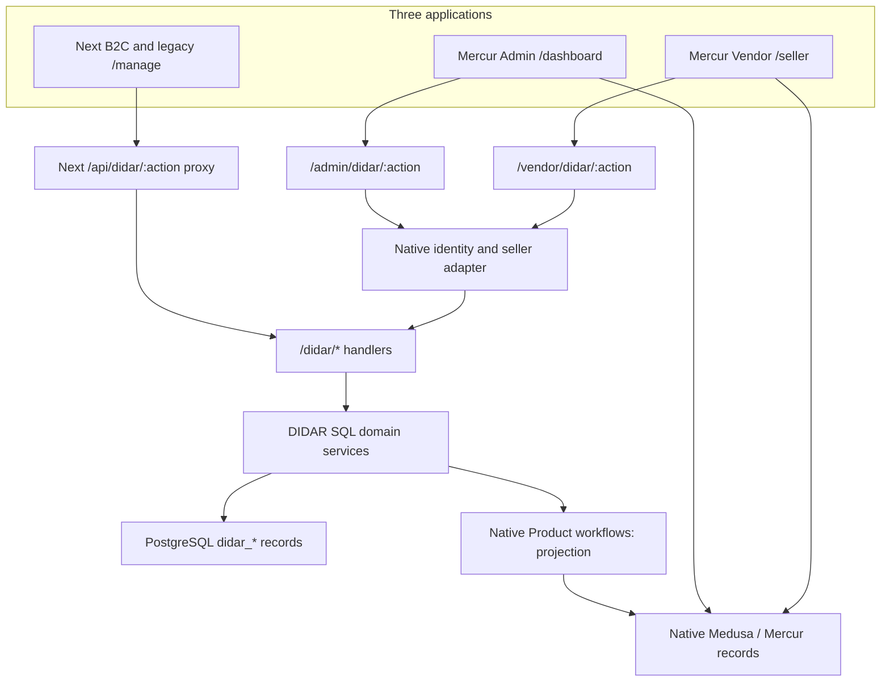

# DIDAR B2C — Mercur / Medusa Core Architecture Audit

**To:** Chief Architect, DIDAR B2C  
**Status:** Source-based technical recommendation; no implementation or architecture change authorized by this report.  
**Audit date:** 17 October 2026  
**Audited DIDAR main:** `0aeec24d2292fb3e60848ac2deaa68b76a478ded`, committed `2026-10-17T05:45:04Z`, “feat(native): recover Mercur Admin and Vendor Didar workspaces”.  
**Official Mercur baseline:** release `v2.3.7`, commit `57fa9cf7de35829ce493a3ace29deb4f36d0838b`.  
**Evidence notation:** D = DIDAR pinned source; N = official Mercur pinned source; M = published Medusa 2.21.2 package. Exact paths, line anchors and inspected symbols appear in the evidence register.

## Executive assessment

DIDAR is a real Mercur/Medusa application with a substantial custom gold-commerce subsystem. It is neither an empty starter nor a fully native Mercur implementation. The latest commit materially changes the assessment: original Mercur Admin and Vendor applications now contain genuine SDK routes, product widgets and custom-field displays, backed by the existing DIDAR services. Describing the latest repository as having no native DIDAR panel integration would be incorrect. [D01–D06, D26]

However, putting existing gold screens inside the native shells has **not unified the underlying commerce models**. Native products are partial projections of DIDAR masters. DIDAR owns its supplier offers, taxonomy, customer credentials, reservations, checkout, orders, payment attempts, fulfillment and financial history in its own PostgreSQL tables. Native Sellers are explicitly linked to DIDAR Suppliers; native Admin/Member identities are explicitly linked to DIDAR users. Native gold-sale orders, offer prices and stock are not populated by this checkout. [D07–D14, D18–D22]

Mercur 2.3.7 already supports shared master products, many seller offers per variant, offer-scoped prices/inventory, product-change approval, typed/filterable attributes, seller members and multi-seller checkout. These cannot be classified as framework gaps. DIDAR-specific measured UID stock, gold-denominated obligations, custody/title distinctions and mixed IRR/fine-gold accounting still require domain extensions; they are not equivalent to generic SKU quantities or monetary payouts. [N01–N12, D15–D17]

**Recommendation:** preserve the working gold domain and complete the native-panel recovery first, while formally reviewing ownership of overlapping generic entities. Do not launch a wholesale rewrite or a bulk migration into native orders. Correct the non-demo migration defect before claiming the native recovery can be installed normally. No framework replacement is justified by the inspected evidence.

## Scope and confidence

This audit inspected the current GitHub repository, tracked lockfile, both panel bootstraps/configuration/extensions, Next proxy and customer state, DIDAR SQL schemas and domain handlers, the official Mercur release source, the **published version-matched `@mercurjs/docs@2.3.7` documentation**, published `@mercurjs/core@2.3.7` code, and relevant published `@medusajs/medusa@2.21.2` routes. SHA-512 hashes of all three downloaded package archives match their exact `bun.lock` integrity values. The comparison is not based on v1 documentation or an unpinned latest-docs site.

Dependency versions verified in manifests and lockfile: Mercur core/admin/vendor/client/dashboard SDK/docs **2.3.7**; Medusa framework/medusa/core flows **2.21.2**; Next **15.5.24**; root package manager **Bun 1.4.3**. Compose declares PostgreSQL **17** and Redis **7**, which should replace any assumption that this repository necessarily deploys PostgreSQL 16. [D01, D25]

**Boundary:** no installed dependency tree, live server database, deployed image or environment file was available in this fresh audit workspace. Published artifacts matched to the lockfile were inspected instead of claiming a running installation was inspected. No dependency installation, application startup, application/API/browser regression suite, hardware test, production deployment or database mutation was performed. Findings labelled “verified” mean source/configuration facts; behavioral consequences are identified as deductions pending reproduction where appropriate.

The repository's prior verification receipt reports 166 backend tests, one native HTTP test and 24 browser tests. Those are **repository-reported historical results**, not tests independently rerun in this audit. They cover disposable Linux QA and explicitly leave staff/pending-supplier/cutover work open. Passing those tests does not resolve the migration defect below. [D26, D27]

## A. Complete AS-IS architecture map

### Runtime and request topology

The last two arrows represent native built-in API journeys, not direct browser-to-database connections. The Medusa backend hosts native APIs, DIDAR routes, jobs and compiled panel assets. PostgreSQL is shared infrastructure but **transactions and domain authorities are separate**. Redis is configured through `redisUrl`; DIDAR stock/finance concurrency relies on PostgreSQL row/advisory locks, not Redis. Actual event-bus/workflow/locking provider resolution remains a deployment verification item. [D02, D08–D12, D25, N13]

### Authority and persistence inventory

| Domain | Current authority and connections | Native integration actually present |
| --- | --- | --- |
| Master catalog | `didar_product`; title, approval, purity, bounds, reference, category and attributes | Unique `native_id` points to native Product. Create uses Mercur workflow; updates use Medusa Product workflow. Native variant is initially `Standard`. Native row is a projection, not the gold source of truth. |
| Taxonomy / discovery | `didar_category`, `didar_collection`, collection-product links, F01–F12 facets, assignments, translation approvals, discovery pages | No category/collection/attribute mapping to corresponding native records was found in the inspected production integration. |
| Seller business identity | `didar_supplier` plus active/approval/commercial profile | `didar_native_seller` gives an explicit approved native Seller→Supplier link; old `native_id` columns alone are not proof of active mapping. |
| People and access | `didar_user`, hashed-password credentials, sessions, merchant membership, supplier grants, content operators | Native `user` and `member` authentication reused; `didar_native_actor` links to DIDAR users. No production native Customer mapping was found. |
| Offers / prices | `didar_offer`, rate, immutable pricing policies and merchant profile/tax versions | `didar_offer.native_id` exists in base schema, but no active production native Offer creation/synchronization was found. |
| Physical stock | Intake batch/line, measured `didar_inventory_item`, UID, optional RFID bindings, reservations, returns, stock count sessions | No native inventory/reservation mirror is created by gold checkout. Offer quantity is derived for itemized stock; legacy mode remains explicit. |
| Cart / checkout | Browser-local cart by shop handle; server quote and transactional checkout | Next forwards to DIDAR APIs, not native `/store/carts`; offer ID and version are revalidated at checkout. |
| Customer orders | `didar_order`, lines, frozen price/contract/store snapshots | Gold orders appear through custom `/didar/orders` native panel pages, not native Mercur order groups. |
| Payment / shipping | `didar_payment_attempt`; explicit sandbox outcomes; line-level fulfillment/tracking | Native Payment/Fulfillment workflows not used for these sales. Live IRR adapter is disabled. |
| Settlement / accounting | Immutable financial events and terms; procurement/allocation/title/handover; journal/posting projections; wallets; Tahesab export outbox | Native payout/commission systems do not own gold obligations. Custom finance controls are predominantly local sandbox gated. |
| Media | Legacy PostgreSQL image bytes; newer sanitized asset/variant bytes; CMS video bytes and approval/ownership metadata | Native local File provider configured separately; native Media/ProductImage records are not the DIDAR approval pipeline. |
| Content / shop growth | DIDAR store settings, invites/context, share attribution, CMS page/version/publication/preset/events | Shared UI rendered in native extensions; public rendering remains Next. No evidence of completed later CRM/campaign/referral roadmap. |

**Primary sources:** D07–D25, D28–D32.

### Mutation and extension structure

`src/api/didar/*/route.ts` generally dispatches into `src/didar/service.ts` and sibling services. Those functions issue parameterized SQL through a separate `pg.Pool` and explicit transactions. All 78 `CREATE TABLE` declarations counted across DIDAR schema files are custom `didar_*` tables. `src/modules`, `src/links` and `src/workflows` contain only starter README files; the gold subsystem is not currently expressed as Medusa custom modules/module links/workflows. Scheduled expiration and financial close call the SQL domain directly. [D08–D12, D23, D32]

This is a framework-convention departure with real maintenance implications, but does not prove raw SQL or database triggers are inherently wrong. They currently enforce important gold invariants. Wrapping transaction-safe services is a lower-risk option than rewriting their SQL and history.

Native product writes occur through a different transaction mechanism from the DIDAR `pg` transaction. Code provides local compensation on some failures, not a single distributed atomic transaction. This distinction is material to recovery. [D09]

## B. Native Mercur vs DIDAR capability matrix

| Domain | Verified native capability | Existing DIDAR implementation | Overlap / genuine delta | Recommended disposition |
| --- | --- | --- | --- | --- |
| Product master and variants | Shared Product, eligibility allowlist, native options/variants, creator attribution and status; no seller ownership. [N01] | Custom master, published/approved flags, gold fields and single default native variant projection. [D07, D09] | General master/lifecycle duplicated; purity and exact physical piece identity are domain additions. Variant axes must be assessed for size/color independently of measured UID. | Keep current master and IDs during recovery; extend native fields/views; assess an approved eventual master authority rather than introduce another master. |
| Categories and collections | Medusa category tree, collections and native panel/API management; Mercur attributes can link to categories. [N03, M02] | Ranked family/category/subcategory, legacy exceptions, stable URLs, governed collections and localized labels. [D13, D14] | A tree is native; enforced ranks, evidence and localization governance extend it. Native Product projection does not carry these relationships today. | Refactor mapping after inventory of stable IDs/URLs; configure native tree where equivalent; retain review/evidence rules. |
| Attributes / facets | Typed select/text/unit/toggle, filter flags, global or product scoped, variant axes backed by ProductOptions. [N03] | F01–F12, assignment review/evidence/validity, four locale vocabularies and curated discovery filters. [D14] | Generic attribute catalog duplicated; assignment evidence and scheduled merchandising go beyond simple values. | Keep governed values; assess native attributes as linked structural storage, not a second writable vocabulary. Never blindly convert every facet into a variant axis. |
| Product requests and approval | ProductChange/action pipeline for creation, updates, variants and attributes, confirm/decline/revision and history. [N04] | `didar_product_request`, own offer/join-master request, grant checks, media and agent attribution. [D07, D29] | Approval queue overlaps; offer/intake/media/commercial approval semantics require adapters. | Extend or link native change requests where equivalent after field-by-field review; retain historical requests unchanged. |
| Sellers / merchants | Seller lifecycle, profile, business/payment details, members, selected-store context, invites and role extension hooks. [N05, N06] | Supplier state and pricing type; separate storefront/member/invite tables; explicit native seller links. [D18–D20, D28] | Business identity/lifecycle/team models overlap; private shopping contexts and supplier settlement terms add semantics. | Reuse native shell/member authentication now; finish lifecycle and staff mapping; ADR for whether merchant vs supplier are the same party. |
| Offers | Native seller listing per master variant with SKU/barcodes/condition and own shipping profile. [N02] | Unique product/supplier/weight offers with making terms, version and stock mode. [D07, D15] | Many sellers per product is native. Weight/making/contract exposure is custom. | Evaluate an Offer adapter/extension, retain historical offer IDs and exact stock; no bulk replacement or dual price writes. |
| Pricing / tax | Offer-scoped price rules, calculated prices, native price lists/promotions/taxes. [N02, N08, M02] | Gold-first calculation, cash/credit merchant profiles, effective versions and immutable quoted snapshots. [D16] | Price management exists natively; bullion-linked IRR calculation and liability allocation are not proven native configuration. | Keep pricing engine; expose through approved workflow/API adapter if native commerce is chosen. Configure native features only when semantics match. |
| Inventory and reservations | Offer-linked inventory item, stock locations, native reservation and checkout validation. [N02, N07] | Exact UID, measured weights, custody/ownership, EPC history, item return and per-piece reservation; explicit legacy stock. [D15] | Native quantity stock does not replace measured gold registry. | Keep serialized stock; possible workflow bridge. Exactly one reservation writer. No fictional unit weights or duplicate native reservation. |
| Carts / checkout | Server cart, offer line links, seller shipping, validation/locking, payment authorization and per-seller split. [N07] | Local cart, server quote, idempotent checkout, rate/profile revalidation, exact stock locking and shop attribution. [D10, D11, D16] | Generic checkout largely parallel; gold freeze and merchant-of-record policy need explicit mapping. | Keep current journey through recovery. Compare native orchestration + gold steps against a bounded custom exception in an ADR. |
| Orders / fulfillment / returns | Medusa Orders, Fulfillment, Returns/Claims/Exchanges; Mercur order groups and seller scope. [N07, M02] | Single DIDAR order with supplier lines, line tracking transitions, UID returns and financial refunds separately. [D10, D11, D15] | Generic order/shipping state overlaps; legal seller, exact units and gold reversal semantics differ. | Preserve all orders; use native custom order pages immediately. Do not manufacture native mirror orders or imply native built-in order totals include gold sales. |
| Customers / auth | Native Customer identity/profile/address APIs and auth actor/provider machinery; native User/Member sessions for panels. [M01, N06] | Separate scrypt credentials, sessions/rate limits and customer history; dual-proof panel identity connection. [D12, D18–D20] | Authentication/profile is a substantial generic duplicate; current native bridging protects history but keeps two credential authorities. | Keep dual-proof transition; propose gradual native-auth convergence via explicit ID map and credential transition. No email auto-merge or forced replacement now. |
| Payments | Native payment collections/sessions, provider authorization/capture/refund hooks and order links. [N07, M02] | Persisted sandbox attempts and explicit outcome confirmation; IranianRial class throws configuration error. [D11, D21] | Provider boundary duplicated; a live gateway is genuinely absent. | Reuse native provider contract if selected by commerce ADR; preserve sandbox and finality invariants; never enable a live path by inference. |
| Commissions / settlement | Configurable commission rules and lines; monetary payout account, provider abstraction and automated capture/payout jobs. [N08, N09] | Making/distribution/retail/VAT price components; GOLD_ONLY/RIAL_ONLY/MIXED obligations and procurement/title/handover/reversals. [D16, D17] | Distribution/making components are not automatically commission. Fine-gold obligations and custody are custom domains. | Keep gold finance and journals. Configure commissions only for a separately approved economic relationship; no double deduction or automated native payout for gold liabilities. |
| Wallet / ledger / external accounting | Native payment/payout records are not evidence of a multi-instrument double-entry gold ledger. [N09] | Immutable event→journal/posting projection; IRR, fine gold µg, custody memo; wallet protections; aggregate Tahesab contract/mocks. [D17, D22, D23] | Gold accounting is a justified extension; real withdrawal/trading and concrete accounting dispatch are absent. | Keep. Extend documented external adapters after provider/spec approval; do not replace with generic payouts. |
| Admin / Vendor UI | Actual native apps, dashboard SDK routes/widgets/custom fields/navigation, typed extension targets. [N10] | Genuine SDK extensions and shared `@didar/ui`; legacy Next management still active. [D03–D06, D24] | Native shell recovered; common catalog/offer forms remain largely custom within it. | Keep SDK integration, extend native detail/list areas further where useful; retire legacy routes only after staff and deep-link parity. |
| Media / CMS | Medusa File providers and ProductImages; Mercur MediaImage, category image workflows; generic field extensions. [N11, M02] | Sanitization/WebP variants/approval/visibility plus PostgreSQL video and versioned page builder. [D30, D31] | File storage overlaps; private approval, provenance and page publication are additional. Native media alone is not proof of an equivalent CMS. | Keep pipeline, extend native screens; assess provider-backed blob storage later with immutable references and integrity checks. |
| Workflows / extensions | Module services, module links, compensated workflows/hooks/events/subscribers/jobs, typed SDK/client. [N12, N13] | SQL services and triggers, action dispatcher, manual native projection compensation, standard panel SDK. [D08–D12, D32] | Native extension infrastructure is underused in backend; not missing. | Incrementally wrap existing services, add typed contracts/outbox/reconciliation, avoid all-at-once ORM migration. |

## C. Keep / Configure / Extend / Refactor / Replace decisions proposed for review

All entries are recommendations, not approvals. Relative effort describes implementation shape, not promised calendar delivery.

| Candidate | Time-to-delivery / complexity | Upgrade and maintenance impact | Integrity / technical risk | Recommendation |
| --- | --- | --- | --- | --- |
| Native Admin/Vendor SDK recovery | Short continuation; low–medium | Good; pinned public extension APIs | Low if historical IDs/grants remain | **Keep + Extend**; complete transition instead of starting a new panel. |
| Non-demo migration wiring | Small targeted change | Improves reproducibility | High delivery risk until fixed | **Refactor** migration ordering and test actual deployment entry point. |
| DIDAR exact stock / gold journals | Reuse gives fastest responsible delivery | Isolate behind stable service interfaces | Replacing would endanger UID/paid facts and reversals | **Keep**, add bridges only when approved. |
| Generic product fields / native projection | Medium; requires field ownership contract | Stronger native integration reduces drift | Current cross-transaction projection has failure windows | **Extend + Refactor**, choose one authority and durable synchronization. |
| Native Offer adoption | Medium–large; depends on seller, variant and stock maps | Potentially improves native reporting/upgrades | High if dual stock/prices or wrong seller economics | **Evaluate extension**, do not replace gold offers now. |
| Category/attribute consolidation | Medium; data/URL mapping dominates | Can reduce duplicate structural management | Moderate–high migration/evidence loss risk | **Configure + Extend** after explicit mapping and Chief Architect approval. |
| Native auth convergence | Medium; several actor/permission cases | Removes long-term duplicate credential maintenance | High lockout/account takeover risk if rushed | **Refactor gradually** with explicit proof and rollback. |
| Native checkout/order orchestration | Largest integration decision | Potential reuse of mature commerce workflows | High: legal seller, rounding, allocations, historical references | **ADR comparison**, no implementation commitment yet. |
| Native payout for gold | Apparent quick reuse is misleading | Generic money provider abstraction useful only as infrastructure | High unit/economic mismatch | **Do not replace gold settlement**. Native payout may serve separately approved monetary fees. |
| Media bytes to File/object provider | Later optimization; medium | Better storage scaling and provider reuse | Risk of losing private controls / broken historical URLs | **Keep now; extend later** under explicit storage ADR. |
| Backend module/workflow alignment | Incremental medium | Improves discoverability, typed contracts, upgrade isolation | Avoid nested independent transaction assumptions | **Refactor at boundaries**, retain proven SQL/constraints. |
| Replace Mercur / Medusa | Longest, highest complexity | Loses pinned native capabilities and upgrade path | High migration/regression risk | **Not justified** by present evidence. |

No justified immediate platform or business-engine replacement was found. A future replacement of one generic authority is only defensible when a mapped native extension wins on both reuse and preservation; semantic similarity alone is insufficient.

## D. Findings: violations, duplication and recovery risks

### F01 — Native identity schema omitted by normal non-demo setup

**Severity: High delivery blocker. Confidence: verified control flow; expected database failure not runtime-reproduced here.**

`didar-seed.ts` returns at lines 116–121 when demo seeding is off. `native-schema.sql` is not executed until line 222, after demo data creation. Root `db:setup` and Compose migration invoke this script; demo seeding defaults false. Native migrations will therefore not create `didar_native_actor` or `didar_native_seller` on a clean normal deployment. Native handler queries require those tables. Existing deployments that already happen to contain them can mask the defect. [D01, D18–D20, D25]

The first native-panel backend test manually applies `native-schema.sql` twice before exercising the adapter. That verifies SQL replay, but not installation through `db:setup` with demo disabled. [D27] The checkpoint document's non-demo migration instructions are thus not supported by this source path.

**Proposed recovery:** move required connection-schema application into the unconditional migration path in a separately reviewed fix. Test empty and populated databases through the exact non-demo installer and artifact-only compiled installer, assert the tables exist and stay empty, then run authenticated native connection tests. No production demo accounts should be created.

### F02 — Two commerce stacks remain available

**Severity: High architectural risk; verified overlap, not proof of duplicated transactions in production.**

Mercur has native offers/carts/order groups/payments/inventory/payouts; gold transactions use independent DIDAR tables. The new panel routes embed the DIDAR service rather than reconnect orders to native commerce. Standard native screens can consequently present a different universe of stock/orders/financial totals from DIDAR extensions. `_navigation.ts` only adds a group; it does not resolve or suppress competing write journeys. Product mutation guarding is narrower than an application-wide commerce authority policy. [N02, N07–N09, D05, D10, D11, D24]

This was an explicit historical project decision in `DECISIONS.md`, so it should not be described as an unexplained accident. It still needs reconciliation with the current reuse-first governance. Protecting gold semantics justifies specialized services; it does not establish that every generic cart/customer/order capability needed rebuilding.

**Proposed recovery:** document authority per field/event, make native generic operational paths read-only or clearly out of scope for gold-linked entities where appropriate, enforce server-side write policy, and compare native workflow integration against a bounded gold-domain exception. Do not create mirror transactions just to fill standard dashboards.

### F03 — Native staff and multi-store semantics are not supported by current identity bridge

**Severity: High cutover gate; verified.**

`native-schema.sql` makes `(actor_type,user_id)` unique; `didar_user` has exactly one supplier for its supplier role. `linked()` accepts native Users only as DIDAR admins and Members only as DIDAR suppliers. This blocks an ordinary DIDAR customer with `didar_merchant_member` rights or a content-operator grant from using those existing delegated capabilities through the native bridge. It also cannot represent a single native Member acting for multiple DIDAR suppliers through store switching. That differs from Mercur's native many-to-many membership model. [D07, D18–D20, D28, N06]

**Proposed recovery:** define per-person identity versus per-store authorization, then extend the bridge without sharing owner accounts or widening staff authority. Cover staff with content-only/onboarding-only/store-only grants, multi-store switching and immediate revocation. Existing capability owners should remain able to work through transitional routes until parity is proven.

### F04 — Native fine-grained permission checks are conditional, not configured RBAC

**Severity: High before staff rollout; verified configuration condition, no exploit claimed.**

The pinned Mercur middleware grants all catalog rights and sets `permissions_enforced=false` when no Permissions module resolver is configured. DIDAR `right()` returns immediately in that condition. Current `medusa-config.ts` configures UI and File modules, not a permission resolver. Native page `permissions` and adapter `right()` checks therefore do not by themselves prove least-privilege RBAC is active. DIDAR role/ownership/supplier-grant checks still run. [N14, D02, D19]

**Proposed recovery:** select a supported permission resolver/implementation, register domain-appropriate rights and verify actual runtime enforcement. Product-scoped permissions for CMS and pricing, and generic `payments` rights for all finance operations, require deliberate decomposition before staff use. A synthetic test assigning `req.permissions` proves a branch, not runtime provider configuration.

### F05 — Product projection is not durably atomic with the gold master

**Severity: High integrity risk; verified mechanism and failure window.**

`catalog.ts` calls a native create/update workflow while the separate DIDAR SQL transaction is open, then writes DIDAR master/collections/audit data. Its catch block tries native compensation, and logs if compensation fails. A process crash or failure in a later enclosing transaction/COMMIT lies outside guaranteed native rollback; the workflow does not share `c`. The update compensation also restores publication from `old.active && old.published`, omitting `old.approved`, unlike the forward condition. [D08, D09]

**Proposed recovery:** maintain a durable projection intent/version/outbox or a reviewed workflow coordination mechanism, idempotent retry, drift report and repair queue. Specify publication safety while projection is stale. Failure injection must include crash after native write, after DIDAR SQL, audit failure, enclosing transaction failure and failed compensation. This audit does not claim observed data corruption.

### F06 — Structural catalog duplication and incomplete projection

**Severity: Medium–High; verified.**

Native master/variants/options, categories/collections, attributes and ProductChange coexist with custom equivalents. Production native Product projection writes basic fields/metadata and a Standard variant at creation, without DIDAR category/collection/facet/price/image relationships. Native generic Product HTTP edits are guarded for linked products; this protects basic authority but leaves native built-in content and reporting incomplete. [N01–N04, D09, D13, D14, D34]

**Proposed recovery:** explicit field mapping and ownership; enrich native detail/list views from canonical DIDAR data first. Decide structural consolidation through an ADR rather than synchronize every duplicated field bidirectionally. Keep URLs, pending classification decisions and evidence.

### F07 — Seller lifecycle has two authorities

**Severity: High governance risk; verified independence, runtime consequence inferred.**

Native Seller lifecycle and DIDAR Supplier approval are distinct records. The adapter checks native existence/membership and DIDAR active/approved status; native `ensureSellerMiddleware` establishes membership, not lifecycle equivalence. Public DIDAR scope/quote/checkout checks DIDAR Supplier state without consulting a native Seller link. Native suspension alone is therefore not a documented all-channel gold-sale stop. [N05, N15, D19, D28, D10, D16]

**Proposed recovery:** choose the commercial lifecycle authority and define event/adapter propagation for suspension/rejection/reactivation, including public gold checkout, pending orders and read-only access to history. Do not infer legal equivalence of “retailer”, “supplier” and native “seller”.

### F08 — Legacy Next management remains a live transition surface

**Severity: Medium transition violation if presented as final architecture; verified.**

`/manage/**` and the proxy's management action allowlist remain active. Next navigation still includes operator/merchant links. Most old components now re-export `@didar/ui`, which reduces code duplication: these are dual entry points to shared services, not proof of two financial engines. The native recovery receipt expressly says role-aware redirects, restricted staff and pending-supplier parity are unfinished. [D24, D26, D33]

**Proposed recovery:** finish role matrix and deep-link/auth handoff; redirect route by route after parity. Keep public customer navigation free of internal management controls after cutover. Do not delete these paths while authorized staff still depend on them.

### F09 — DIDAR backend bypasses normal module/workflow observability

**Severity: Medium maintainability/upgrade concern; verified.**

Raw SQL services, separate Pool, action dispatcher, hand-run SQL resources and direct native-table membership reads couple DIDAR to schema and runtime conventions. Native module links, workflow hooks, Query graph and type augmentation are largely unused. The use of direct SQL improves some immediate transaction guarantees but means native events, workflow dashboards and standard APIs do not automatically observe gold actions. [N12–N14, D08–D12, D19, D32]

**Proposed recovery:** service boundaries, typed action DTOs, workflows around existing transactions, versioned migrations and explicit events/outbox. Do not scatter native module CRUD inside an assumed shared `pg` transaction or rewrite all database constraints to satisfy a style rule.

### F10 — Financial/live integration gaps are real and correctly bounded

**Severity: Launch dependencies; verified.**

Live IRR provider initialization/confirmation throw `LIVE_GATEWAY_NOT_CONFIGURED`; provider selection allows sandbox only in local/staging. Financial writes call `localFinance()` requiring local+sandbox. Tahesab concrete request construction throws `BLOCKED_BY_SPEC`; nightly close prepares local dry-run aggregates. Fine-gold entitlement, purchasing intent and sandbox purchase facts are not live bullion execution. Manual rate source exists; a verified live rate feed is not implemented in the inspected provider. [D17, D21–D23, D35]

These are genuine missing production integrations, not a reason to replace Mercur or to pretend native Stripe payouts meet Iranian gold settlement. Keep their boundaries explicit until provider contracts and Chief Architect acceptance are available.

### F11 — Media storage and approval need one clear contract

**Severity: Medium scaling/UX issue; verified coexistence, no measured performance failure.**

The native local File provider, legacy DIDAR image bytes, sanitized assets/variants and CMS video bytes coexist. Native `MediaImage` provides generic category image metadata; it does not replace approval/provenance/private ownership. PostgreSQL video/source bytes enlarge database backups; no workload benchmark was run here. [D02, D30, D31, N11]

**Proposed recovery:** keep approvals and immutable references canonical. If storage scale justifies File/object-provider adoption, transfer bytes with checksum verification, stable protected URLs and preserved history. Avoid re-uploading everything or exposing merchant-private sources.

### F12 — Source is not deployment evidence

**Severity: Release governance gate.**

The audited default branch includes a fresh native recovery commit. A second remote branch, `staging/debian13-phase2-00447d3`, was observed at `ddbd31b1550390510b1356fda2582bf11890c4fe`. Its name alone cannot identify the deployed revision. This audit did not contact staging or read its database. Historical screenshots/receipts are useful evidence, but cannot certify that the domain currently serves these panels or that staff/hardware/live accounting works.

**Proposed recovery:** read-only deployed build SHA, resolved modules, migrations and route checks before any deployment claim. Keep engineering completion separate from owner acceptance and physical device acceptance.

## E. Proposed architecture recovery plan

This plan preserves all source and business facts. It does not authorize modifying fundamental architecture.

| Order | Work package | Prerequisite / scope | Exit evidence |
| --- | --- | --- | --- |
| R0 | Preserve and inventory | Pin source/image/dependency hashes; snapshot actual DB/files; read-only counts and per-row fingerprints | Restorable backup; native/DIDAR product and seller link report; UID/offer/order/payment/financial/media fingerprints; no invented records. |
| R1 | Correct installer and establish integrity baseline | Review F01 independently of larger migration decisions | Non-demo fresh + populated upgrade, repeat run and artifact-only installer all create empty connection tables; business/history fingerprints unchanged. |
| R2 | Finish native role recovery | Existing approved three-workspace architecture; review identity and permission ADR | Real Admin, owner Vendor, restricted staff, content operator, pending/inactive supplier and multi-store journeys; native permissions provider actually enforced; cross-merchant API/count/media denial; revocation tests. |
| R3 | Enforce authority / projection safety | Chief Architect approves authority inventory | Durable/idempotent native product projection; crash recovery and drift reporting; generic competing writes governed server-side; no second stock or journal authority. |
| R4 | Complete UI cutover | Each role/feature passes R2/R3 parity | Native paths for product/offer/intake/UID/media/CMS/pricing/order/finance as applicable; old deep IDs preserved; role-aware login/deep-link handoff; B2C customer-only navigation. |
| R5 | Decide generic entity convergence | ADRs for catalog, identity, seller, offer and checkout economics | Small disposable vertical-slice comparison; exact ID/price/unit/permission map; measured effort and regression result; explicit owner approval for fundamental changes. |
| R6 | Execute only approved bounded integration | R5 decision; incremental additive changes | Historical APIs/URLs/orders survive; one writer per invariant; no duplicate native/DIDAR reserves or payouts; rollback via routing/feature switch, not deleting financial facts. |
| R7 | Production integration / operational qualification | Verified provider and accounting specs; separately approved release | Gateway finality/refund/replay tests; gold source/settlement controls; concrete accounting reconciliation; native/browser UAT; deployed SHA; backup restore; physical UID/RFID/printer acceptance as applicable. |

### Preservation requirements

- Retain immutable IDs/public keys, canonical and historical URLs, UID/RFID binding history, measured weights/purity, offer versions, reservation records, paid prices/tax/profile/contracts/store snapshots and original fulfillment/refund references.
- Preserve append-only events and journals; adjustments are new events, never historical restatement to match new native totals.
- Any proposed map from DIDAR to native entities must include uniqueness, missing-link detection, versioning, who may write, deletion behavior, replay and reconciliation. Do not infer linkage by email, product title or supplier name.
- Additive schema change and per-domain routing rollback precede retirement. Keep source history and read compatibility even if a future native entity becomes authoritative.
- Restore tests must include bytes/media plus SQL, not just row counts. Existing QA evidence covers selected historical snapshots, not every possible owner database.

### Smallest useful comparison slice for R5

In an explicitly disposable database, map one approved master, two suppliers and their native sellers, two different measured UID weights, a cash quote, a credit quote, one native identity with restricted permissions and one DIDAR order. Evaluate whether native Offer/cart workflow hooks can invoke the **existing** pricing/reservation services without a second reservation or financial event. Include rate changes, payment replay/failure, expiry, partial settlement and return after settlement. Do not mutate real historical orders to prove compatibility. This is a proposed validation task, not implementation undertaken by this audit.

## F. Recommendations and questions for Chief Architect review

1. **Commerce authority:** should native Cart/Order/Offer become the orchestration backbone with gold-domain steps, or should a formally bounded gold commerce exception remain? Recommend a measured slice before deciding; current evidence does not establish safe drop-in replacement.
2. **Economic seller:** DIDAR currently records the customer-facing sale while suppliers carry obligations. Does a native per-seller order mean a legal merchant sale, a supplier allocation, or an operational grouping? This must be resolved before adopting native order splitting/commissions.
3. **Party model:** are supplier, retail merchant and seller the same entity in every approved commercial type? Recommend native Seller for marketplace presence with explicitly mapped business-party roles, subject to the existing commercial model.
4. **Identity:** approve a per-person native identity with scoped merchant memberships, or preserve separate credentials as an explicitly temporary exception? Recommend eventual native auth convergence with dual proof and retained DIDAR history, not automatic email matching.
5. **Catalog authority:** should native Product own general descriptive/variant/category/attribute structure while DIDAR owns measured items and governed gold fields, or remain a projection? Recommend one authority per field; no bidirectional free editing.
6. **Access control:** which supported permissions implementation supplies actual native Admin/Member rights, and which distinct rights cover price/tax policy, treasury approval, ledger close, media review and CMS publication? Recommend default-deny staff roles before expanding delegated access.
7. **Settlement:** confirm that native monetary commission/payout cannot discharge a gold obligation or trigger a second supplier payment. Recommend keeping the existing multi-instrument ledger as authority.
8. **Cutover acceptance:** what exact staff/pending-state journeys must pass before legacy `/manage` redirects? Recommend the role/feature matrix above and real native browser journeys, not build-only completion.
9. **Production dependencies:** assign approved contracts for gold rate, gateway, bullion execution/custody, concrete Tahesab export and legal/accounting policy. These remain dependencies even if native panels are complete.

### Suggested ADR queue — proposed, not accepted

| Proposed ADR | Required content / alternatives |
| --- | --- |
| ADR-CORE-01: Domain and field authority | Current DIDAR authority vs native authority vs read-only projection; economic seller and units; link and deletion policy. |
| ADR-CORE-02: Identity, team and permission convergence | Native person→scoped parties vs dual-auth exception; migration proof, staff privileges, multi-store and revocation. |
| ADR-CORE-03: Offer/cart/order integration | Native workflow + existing gold services vs bounded custom engine; no duplicate stock/event/payout, evidence from R5 slice. |
| ADR-CORE-04: Catalog and discovery mapping | Native category/attribute structure + governed extensions vs retained DIDAR structure; stable URLs, translations/evidence and variant semantics. |
| ADR-CORE-05: Projection consistency and migration lifecycle | Durable intent/reconciliation vs compensated workflow coordination; crash states, retries, schema versioning and restoration. |
| ADR-CORE-06: Media persistence | PostgreSQL bytes vs File/object provider with existing approvals; performance evidence, privacy and historical URL preservation. |

For each ADR, record business requirement, present implementation, alternatives, selected recommendation, rationale, risks/dependencies and impact on existing behavior. Approval remains with the Chief Architect/owner under project governance.

## Evidence register

All DIDAR links below are pinned to the audited SHA; Mercur links are pinned to the official release SHA. Line anchors identify inspected evidence, not claimed runtime execution. M references are local copies of the exact published Medusa archive verified against the lockfile.

### D01 — DIDAR dependency and installer declarations

- [package.json:12](https://github.com/alirezasefidpour747/didar-b2c-marketplace/blob/0aeec24d2292fb3e60848ac2deaa68b76a478ded/package.json#L12) — `db:setup`
- [packages/api/package.json:31](https://github.com/alirezasefidpour747/didar-b2c-marketplace/blob/0aeec24d2292fb3e60848ac2deaa68b76a478ded/packages/api/package.json#L31) — `"dependencies"`
- [apps/admin/package.json:13](https://github.com/alirezasefidpour747/didar-b2c-marketplace/blob/0aeec24d2292fb3e60848ac2deaa68b76a478ded/apps/admin/package.json#L13) — `"@mercurjs/admin"`
- [apps/vendor/package.json:13](https://github.com/alirezasefidpour747/didar-b2c-marketplace/blob/0aeec24d2292fb3e60848ac2deaa68b76a478ded/apps/vendor/package.json#L13) — `"@mercurjs/vendor"`
- [apps/storefront/package.json:31](https://github.com/alirezasefidpour747/didar-b2c-marketplace/blob/0aeec24d2292fb3e60848ac2deaa68b76a478ded/apps/storefront/package.json#L31) — `"next"`
- [bun.lock:950](https://github.com/alirezasefidpour747/didar-b2c-marketplace/blob/0aeec24d2292fb3e60848ac2deaa68b76a478ded/bun.lock#L950) — `"@mercurjs/core": [`

### D02 — Runtime configuration

- [packages/api/medusa-config.ts:28](https://github.com/alirezasefidpour747/didar-b2c-marketplace/blob/0aeec24d2292fb3e60848ac2deaa68b76a478ded/packages/api/medusa-config.ts#L28) — `module.exports`

### D03 — Native Admin app and route

- [apps/admin/src/main.tsx:4](https://github.com/alirezasefidpour747/didar-b2c-marketplace/blob/0aeec24d2292fb3e60848ac2deaa68b76a478ded/apps/admin/src/main.tsx#L4) — `import App`
- [apps/admin/src/routes/didar/page.tsx:4](https://github.com/alirezasefidpour747/didar-b2c-marketplace/blob/0aeec24d2292fb3e60848ac2deaa68b76a478ded/apps/admin/src/routes/didar/page.tsx#L4) — `export`
- [apps/admin/src/routes/didar/orders/page.tsx:4](https://github.com/alirezasefidpour747/didar-b2c-marketplace/blob/0aeec24d2292fb3e60848ac2deaa68b76a478ded/apps/admin/src/routes/didar/orders/page.tsx#L4) — `export`

### D04 — Native Vendor app and route

- [apps/vendor/src/main.tsx:4](https://github.com/alirezasefidpour747/didar-b2c-marketplace/blob/0aeec24d2292fb3e60848ac2deaa68b76a478ded/apps/vendor/src/main.tsx#L4) — `import App`
- [apps/vendor/src/routes/didar/page.tsx:4](https://github.com/alirezasefidpour747/didar-b2c-marketplace/blob/0aeec24d2292fb3e60848ac2deaa68b76a478ded/apps/vendor/src/routes/didar/page.tsx#L4) — `export`

### D05 — Native navigation extensions

- [apps/admin/src/_navigation.ts:1](https://github.com/alirezasefidpour747/didar-b2c-marketplace/blob/0aeec24d2292fb3e60848ac2deaa68b76a478ded/apps/admin/src/_navigation.ts#L1) — `defineNavigationConfig`
- [apps/vendor/src/_navigation.ts:1](https://github.com/alirezasefidpour747/didar-b2c-marketplace/blob/0aeec24d2292fb3e60848ac2deaa68b76a478ded/apps/vendor/src/_navigation.ts#L1) — `defineNavigationConfig`

### D06 — Native extension mechanisms used

- [apps/admin/src/widgets/didar-product.tsx:1](https://github.com/alirezasefidpour747/didar-b2c-marketplace/blob/0aeec24d2292fb3e60848ac2deaa68b76a478ded/apps/admin/src/widgets/didar-product.tsx#L1)
- [apps/vendor/src/widgets/didar-product.tsx:1](https://github.com/alirezasefidpour747/didar-b2c-marketplace/blob/0aeec24d2292fb3e60848ac2deaa68b76a478ded/apps/vendor/src/widgets/didar-product.tsx#L1)
- [apps/admin/src/custom-fields/product.tsx:1](https://github.com/alirezasefidpour747/didar-b2c-marketplace/blob/0aeec24d2292fb3e60848ac2deaa68b76a478ded/apps/admin/src/custom-fields/product.tsx#L1)
- [apps/admin/vite.config.ts:10](https://github.com/alirezasefidpour747/didar-b2c-marketplace/blob/0aeec24d2292fb3e60848ac2deaa68b76a478ded/apps/admin/vite.config.ts#L10) — `mercurDashboardPlugin`
- [apps/vendor/vite.config.ts:10](https://github.com/alirezasefidpour747/didar-b2c-marketplace/blob/0aeec24d2292fb3e60848ac2deaa68b76a478ded/apps/vendor/vite.config.ts#L10) — `mercurDashboardPlugin`

### D07 — Base and commerce schema

- [packages/api/src/didar/schema.sql:1](https://github.com/alirezasefidpour747/didar-b2c-marketplace/blob/0aeec24d2292fb3e60848ac2deaa68b76a478ded/packages/api/src/didar/schema.sql#L1) — `CREATE TABLE`
- [packages/api/src/didar/commerce-schema.sql:11](https://github.com/alirezasefidpour747/didar-b2c-marketplace/blob/0aeec24d2292fb3e60848ac2deaa68b76a478ded/packages/api/src/didar/commerce-schema.sql#L11) — `CREATE TABLE`

### D08 — Separate Pool and transaction

- [packages/api/src/didar/db.ts:2](https://github.com/alirezasefidpour747/didar-b2c-marketplace/blob/0aeec24d2292fb3e60848ac2deaa68b76a478ded/packages/api/src/didar/db.ts#L2) — `export const db`
- [packages/api/src/didar/db.ts:14](https://github.com/alirezasefidpour747/didar-b2c-marketplace/blob/0aeec24d2292fb3e60848ac2deaa68b76a478ded/packages/api/src/didar/db.ts#L14) — `export async function transaction`

### D09 — Native product projection and compensation

- [packages/api/src/didar/catalog.ts:304](https://github.com/alirezasefidpour747/didar-b2c-marketplace/blob/0aeec24d2292fb3e60848ac2deaa68b76a478ded/packages/api/src/didar/catalog.ts#L304) — `let native =`
- [packages/api/src/didar/catalog.ts:361](https://github.com/alirezasefidpour747/didar-b2c-marketplace/blob/0aeec24d2292fb3e60848ac2deaa68b76a478ded/packages/api/src/didar/catalog.ts#L361) — `const previousNative`
- [packages/api/src/didar/catalog.ts:455](https://github.com/alirezasefidpour747/didar-b2c-marketplace/blob/0aeec24d2292fb3e60848ac2deaa68b76a478ded/packages/api/src/didar/catalog.ts#L455) — `Native workflows use their own transaction`

### D10 — DIDAR action dispatcher and checkout/order authority

- [packages/api/src/didar/service.ts:69](https://github.com/alirezasefidpour747/didar-b2c-marketplace/blob/0aeec24d2292fb3e60848ac2deaa68b76a478ded/packages/api/src/didar/service.ts#L69) — `export async function perform`
- [packages/api/src/didar/service.ts:230](https://github.com/alirezasefidpour747/didar-b2c-marketplace/blob/0aeec24d2292fb3e60848ac2deaa68b76a478ded/packages/api/src/didar/service.ts#L230) — `if (action === "checkout")`
- [packages/api/src/didar/service.ts:406](https://github.com/alirezasefidpour747/didar-b2c-marketplace/blob/0aeec24d2292fb3e60848ac2deaa68b76a478ded/packages/api/src/didar/service.ts#L406) — `if (action === "orders")`

### D11 — Payment and fulfillment

- [packages/api/src/didar/commerce.ts:29](https://github.com/alirezasefidpour747/didar-b2c-marketplace/blob/0aeec24d2292fb3e60848ac2deaa68b76a478ded/packages/api/src/didar/commerce.ts#L29) — `async function payment`
- [packages/api/src/didar/commerce.ts:147](https://github.com/alirezasefidpour747/didar-b2c-marketplace/blob/0aeec24d2292fb3e60848ac2deaa68b76a478ded/packages/api/src/didar/commerce.ts#L147) — `async function fulfillment`

### D12 — DIDAR credentials and sessions

- [packages/api/src/didar/auth.ts:9](https://github.com/alirezasefidpour747/didar-b2c-marketplace/blob/0aeec24d2292fb3e60848ac2deaa68b76a478ded/packages/api/src/didar/auth.ts#L9) — `export function hashPassword`
- [packages/api/src/didar/auth.ts:24](https://github.com/alirezasefidpour747/didar-b2c-marketplace/blob/0aeec24d2292fb3e60848ac2deaa68b76a478ded/packages/api/src/didar/auth.ts#L24) — `export async function sessionUser`
- [packages/api/src/didar/service.ts:143](https://github.com/alirezasefidpour747/didar-b2c-marketplace/blob/0aeec24d2292fb3e60848ac2deaa68b76a478ded/packages/api/src/didar/service.ts#L143) — `if (action === "register" ||`

### D13 — Taxonomy storage and resolver

- [packages/api/src/didar/taxonomy-schema.sql:21](https://github.com/alirezasefidpour747/didar-b2c-marketplace/blob/0aeec24d2292fb3e60848ac2deaa68b76a478ded/packages/api/src/didar/taxonomy-schema.sql#L21) — `CREATE OR REPLACE FUNCTION didar_taxonomy_valid`
- [packages/api/src/didar/taxonomy.ts:34](https://github.com/alirezasefidpour747/didar-b2c-marketplace/blob/0aeec24d2292fb3e60848ac2deaa68b76a478ded/packages/api/src/didar/taxonomy.ts#L34) — `publicProductLink`

### D14 — Facets, collection governance, localized vocabulary and search

- [packages/api/src/didar/facets-schema.sql:4](https://github.com/alirezasefidpour747/didar-b2c-marketplace/blob/0aeec24d2292fb3e60848ac2deaa68b76a478ded/packages/api/src/didar/facets-schema.sql#L4) — `CREATE TABLE`
- [packages/api/src/didar/facets.ts:160](https://github.com/alirezasefidpour747/didar-b2c-marketplace/blob/0aeec24d2292fb3e60848ac2deaa68b76a478ded/packages/api/src/didar/facets.ts#L160) — `classificationWrite`
- [packages/api/src/didar/discovery.ts:1](https://github.com/alirezasefidpour747/didar-b2c-marketplace/blob/0aeec24d2292fb3e60848ac2deaa68b76a478ded/packages/api/src/didar/discovery.ts#L1)

### D15 — Measured stock, permissions and piece reservations

- [packages/api/src/didar/phase1-schema.sql:45](https://github.com/alirezasefidpour747/didar-b2c-marketplace/blob/0aeec24d2292fb3e60848ac2deaa68b76a478ded/packages/api/src/didar/phase1-schema.sql#L45) — `CREATE TABLE IF NOT EXISTS didar_inventory_item`
- [packages/api/src/didar/phase1.ts:1](https://github.com/alirezasefidpour747/didar-b2c-marketplace/blob/0aeec24d2292fb3e60848ac2deaa68b76a478ded/packages/api/src/didar/phase1.ts#L1)
- [packages/api/src/didar/item-stock.ts:3](https://github.com/alirezasefidpour747/didar-b2c-marketplace/blob/0aeec24d2292fb3e60848ac2deaa68b76a478ded/packages/api/src/didar/item-stock.ts#L3) — `export async function reserveItems`
- [packages/api/src/didar/permissions.ts:24](https://github.com/alirezasefidpour747/didar-b2c-marketplace/blob/0aeec24d2292fb3e60848ac2deaa68b76a478ded/packages/api/src/didar/permissions.ts#L24) — `export async function authorize`

### D16 — Gold pricing, profile versions and quotes

- [packages/api/src/didar/pricing.ts:1](https://github.com/alirezasefidpour747/didar-b2c-marketplace/blob/0aeec24d2292fb3e60848ac2deaa68b76a478ded/packages/api/src/didar/pricing.ts#L1)
- [packages/api/src/didar/merchant-pricing-schema.sql:4](https://github.com/alirezasefidpour747/didar-b2c-marketplace/blob/0aeec24d2292fb3e60848ac2deaa68b76a478ded/packages/api/src/didar/merchant-pricing-schema.sql#L4) — `CREATE TABLE`
- [packages/api/src/didar/merchant-profiles.ts:190](https://github.com/alirezasefidpour747/didar-b2c-marketplace/blob/0aeec24d2292fb3e60848ac2deaa68b76a478ded/packages/api/src/didar/merchant-profiles.ts#L190) — `quoteOffer`
- [packages/api/src/didar/merchant-quote.ts:16](https://github.com/alirezasefidpour747/didar-b2c-marketplace/blob/0aeec24d2292fb3e60848ac2deaa68b76a478ded/packages/api/src/didar/merchant-quote.ts#L16) — `export async function cartQuote`

### D17 — Gold financial source events and procurement

- [packages/api/src/didar/finance-schema.sql:4](https://github.com/alirezasefidpour747/didar-b2c-marketplace/blob/0aeec24d2292fb3e60848ac2deaa68b76a478ded/packages/api/src/didar/finance-schema.sql#L4) — `CREATE TABLE`
- [packages/api/src/didar/finance.ts:38](https://github.com/alirezasefidpour747/didar-b2c-marketplace/blob/0aeec24d2292fb3e60848ac2deaa68b76a478ded/packages/api/src/didar/finance.ts#L38) — `export function localFinance`
- [packages/api/src/didar/finance-procurement.ts:106](https://github.com/alirezasefidpour747/didar-b2c-marketplace/blob/0aeec24d2292fb3e60848ac2deaa68b76a478ded/packages/api/src/didar/finance-procurement.ts#L106) — `export async function procurementWrite`
- [packages/api/src/didar/finance-assets.ts:3](https://github.com/alirezasefidpour747/didar-b2c-marketplace/blob/0aeec24d2292fb3e60848ac2deaa68b76a478ded/packages/api/src/didar/finance-assets.ts#L3) — `recordIntake`

### D18 — Native identity tables and installer branch

- [packages/api/src/didar/native-schema.sql:2](https://github.com/alirezasefidpour747/didar-b2c-marketplace/blob/0aeec24d2292fb3e60848ac2deaa68b76a478ded/packages/api/src/didar/native-schema.sql#L2) — `CREATE TABLE`
- [packages/api/src/scripts/didar-seed.ts:116](https://github.com/alirezasefidpour747/didar-b2c-marketplace/blob/0aeec24d2292fb3e60848ac2deaa68b76a478ded/packages/api/src/scripts/didar-seed.ts#L116) — `if (!seedDemo)`
- [packages/api/src/scripts/didar-seed.ts:222](https://github.com/alirezasefidpour747/didar-b2c-marketplace/blob/0aeec24d2292fb3e60848ac2deaa68b76a478ded/packages/api/src/scripts/didar-seed.ts#L222) — `"src/didar/native-schema.sql"`

### D19 — Native actor adapter, lifecycle checks, conditional rights

- [packages/api/src/didar/native.ts:39](https://github.com/alirezasefidpour747/didar-b2c-marketplace/blob/0aeec24d2292fb3e60848ac2deaa68b76a478ded/packages/api/src/didar/native.ts#L39) — `function right`
- [packages/api/src/didar/native.ts:64](https://github.com/alirezasefidpour747/didar-b2c-marketplace/blob/0aeec24d2292fb3e60848ac2deaa68b76a478ded/packages/api/src/didar/native.ts#L64) — `async function linked`
- [packages/api/src/didar/native.ts:166](https://github.com/alirezasefidpour747/didar-b2c-marketplace/blob/0aeec24d2292fb3e60848ac2deaa68b76a478ded/packages/api/src/didar/native.ts#L166) — `action === "seller-links"`

### D20 — Native identity proof, trusted context and workspace

- [packages/api/src/didar/native.ts:110](https://github.com/alirezasefidpour747/didar-b2c-marketplace/blob/0aeec24d2292fb3e60848ac2deaa68b76a478ded/packages/api/src/didar/native.ts#L110) — `action === "connect"`
- [packages/api/src/didar/native-context.ts:2](https://github.com/alirezasefidpour747/didar-b2c-marketplace/blob/0aeec24d2292fb3e60848ac2deaa68b76a478ded/packages/api/src/didar/native-context.ts#L2) — `nativeActors`
- [packages/didar-ui/src/native-workspace.tsx:7](https://github.com/alirezasefidpour747/didar-b2c-marketplace/blob/0aeec24d2292fb3e60848ac2deaa68b76a478ded/packages/didar-ui/src/native-workspace.tsx#L7) — `export function NativeWorkspace`
- [packages/api/src/api/middlewares.ts:5](https://github.com/alirezasefidpour747/didar-b2c-marketplace/blob/0aeec24d2292fb3e60848ac2deaa68b76a478ded/packages/api/src/api/middlewares.ts#L5) — `export default`

### D21 — Sandbox-only payment boundary

- [packages/api/src/didar/payment-provider.ts:59](https://github.com/alirezasefidpour747/didar-b2c-marketplace/blob/0aeec24d2292fb3e60848ac2deaa68b76a478ded/packages/api/src/didar/payment-provider.ts#L59) — `export class IranianRialPaymentProvider`
- [packages/api/src/didar/payment-provider.ts:79](https://github.com/alirezasefidpour747/didar-b2c-marketplace/blob/0aeec24d2292fb3e60848ac2deaa68b76a478ded/packages/api/src/didar/payment-provider.ts#L79) — `export function paymentProvider`

### D22 — Multi-instrument journal and wallet protections

- [packages/api/src/didar/finance-ledger-schema.sql:3](https://github.com/alirezasefidpour747/didar-b2c-marketplace/blob/0aeec24d2292fb3e60848ac2deaa68b76a478ded/packages/api/src/didar/finance-ledger-schema.sql#L3) — `CREATE TABLE`
- [packages/api/src/didar/finance-ledger.ts:58](https://github.com/alirezasefidpour747/didar-b2c-marketplace/blob/0aeec24d2292fb3e60848ac2deaa68b76a478ded/packages/api/src/didar/finance-ledger.ts#L58) — `export async function projectEvent`
- [packages/api/src/didar/finance-wallet.ts:59](https://github.com/alirezasefidpour747/didar-b2c-marketplace/blob/0aeec24d2292fb3e60848ac2deaa68b76a478ded/packages/api/src/didar/finance-wallet.ts#L59) — `export async function walletWrite`

### D23 — Accounting boundary and dry-run close

- [packages/api/src/didar/tahesab-contract.ts:98](https://github.com/alirezasefidpour747/didar-b2c-marketplace/blob/0aeec24d2292fb3e60848ac2deaa68b76a478ded/packages/api/src/didar/tahesab-contract.ts#L98) — `export function concreteTahesabRequest`
- [packages/api/src/didar/tahesab.ts:20](https://github.com/alirezasefidpour747/didar-b2c-marketplace/blob/0aeec24d2292fb3e60848ac2deaa68b76a478ded/packages/api/src/didar/tahesab.ts#L20) — `export async function createClose`
- [packages/api/src/jobs/didar-fin-close.ts:4](https://github.com/alirezasefidpour747/didar-b2c-marketplace/blob/0aeec24d2292fb3e60848ac2deaa68b76a478ded/packages/api/src/jobs/didar-fin-close.ts#L4) — `export default`

### D24 — Customer proxy and legacy shared surfaces

- [apps/storefront/src/app/api/didar/[action]/route.ts:2](https://github.com/alirezasefidpour747/didar-b2c-marketplace/blob/0aeec24d2292fb3e60848ac2deaa68b76a478ded/apps/storefront/src/app/api/didar/[action]/route.ts#L2) — `const allowed`
- [apps/storefront/src/components/didar/manage.tsx:2](https://github.com/alirezasefidpour747/didar-b2c-marketplace/blob/0aeec24d2292fb3e60848ac2deaa68b76a478ded/apps/storefront/src/components/didar/manage.tsx#L2) — `export *`
- [apps/storefront/src/app/manage/admin/page.tsx:1](https://github.com/alirezasefidpour747/didar-b2c-marketplace/blob/0aeec24d2292fb3e60848ac2deaa68b76a478ded/apps/storefront/src/app/manage/admin/page.tsx#L1)

### D25 — Compose infrastructure and non-demo installer

- [compose.yaml:3](https://github.com/alirezasefidpour747/didar-b2c-marketplace/blob/0aeec24d2292fb3e60848ac2deaa68b76a478ded/compose.yaml#L3) — `postgres:`
- [compose.yaml:40](https://github.com/alirezasefidpour747/didar-b2c-marketplace/blob/0aeec24d2292fb3e60848ac2deaa68b76a478ded/compose.yaml#L40) — `DIDAR_SEED_DEMO`
- [package.json:12](https://github.com/alirezasefidpour747/didar-b2c-marketplace/blob/0aeec24d2292fb3e60848ac2deaa68b76a478ded/package.json#L12) — `db:setup`

### D26 — Prior verification and remaining gates

- [verification/mercur-native/RESULTS.md:1](https://github.com/alirezasefidpour747/didar-b2c-marketplace/blob/0aeec24d2292fb3e60848ac2deaa68b76a478ded/verification/mercur-native/RESULTS.md#L1)
- [docs/MERCUR_NATIVE_RECOVERY_IMPLEMENTATION.md:27](https://github.com/alirezasefidpour747/didar-b2c-marketplace/blob/0aeec24d2292fb3e60848ac2deaa68b76a478ded/docs/MERCUR_NATIVE_RECOVERY_IMPLEMENTATION.md#L27) — `## Verification`

### D27 — Native tests construct schema separately

- [tests/native-panels.test.ts:38](https://github.com/alirezasefidpour747/didar-b2c-marketplace/blob/0aeec24d2292fb3e60848ac2deaa68b76a478ded/tests/native-panels.test.ts#L38) — `native identity migration`
- [tests/native-panels.test.ts:46](https://github.com/alirezasefidpour747/didar-b2c-marketplace/blob/0aeec24d2292fb3e60848ac2deaa68b76a478ded/tests/native-panels.test.ts#L46) — `"packages/api/src/didar/native-schema.sql"`
- [tests/browser/native-panels.spec.ts:1](https://github.com/alirezasefidpour747/didar-b2c-marketplace/blob/0aeec24d2292fb3e60848ac2deaa68b76a478ded/tests/browser/native-panels.spec.ts#L1)

### D28 — Shop/member/context authorization

- [packages/api/src/didar/storefront.ts:15](https://github.com/alirezasefidpour747/didar-b2c-marketplace/blob/0aeec24d2292fb3e60848ac2deaa68b76a478ded/packages/api/src/didar/storefront.ts#L15) — `export async function merchantAccess`
- [packages/api/src/didar/storefront.ts:69](https://github.com/alirezasefidpour747/didar-b2c-marketplace/blob/0aeec24d2292fb3e60848ac2deaa68b76a478ded/packages/api/src/didar/storefront.ts#L69) — `export async function storeScope`
- [packages/api/src/didar/storefront-schema.sql:2](https://github.com/alirezasefidpour747/didar-b2c-marketplace/blob/0aeec24d2292fb3e60848ac2deaa68b76a478ded/packages/api/src/didar/storefront-schema.sql#L2) — `CREATE TABLE`

### D29 — Product request and onboarding

- [packages/api/src/didar/onboarding.ts:6](https://github.com/alirezasefidpour747/didar-b2c-marketplace/blob/0aeec24d2292fb3e60848ac2deaa68b76a478ded/packages/api/src/didar/onboarding.ts#L6) — `export async function onboarding`
- [packages/api/src/didar/catalog.ts:961](https://github.com/alirezasefidpour747/didar-b2c-marketplace/blob/0aeec24d2292fb3e60848ac2deaa68b76a478ded/packages/api/src/didar/catalog.ts#L961) — `export async function submitProductRequest`

### D30 — Sanitized and governed media

- [packages/api/src/didar/onboarding-schema.sql:13](https://github.com/alirezasefidpour747/didar-b2c-marketplace/blob/0aeec24d2292fb3e60848ac2deaa68b76a478ded/packages/api/src/didar/onboarding-schema.sql#L13) — `CREATE TABLE IF NOT EXISTS didar_media_asset`
- [packages/api/src/didar/media.ts:1](https://github.com/alirezasefidpour747/didar-b2c-marketplace/blob/0aeec24d2292fb3e60848ac2deaa68b76a478ded/packages/api/src/didar/media.ts#L1)
- [packages/api/src/didar/media-processing.ts:1](https://github.com/alirezasefidpour747/didar-b2c-marketplace/blob/0aeec24d2292fb3e60848ac2deaa68b76a478ded/packages/api/src/didar/media-processing.ts#L1)

### D31 — Versioned CMS and video

- [packages/api/src/didar/content-schema.sql:2](https://github.com/alirezasefidpour747/didar-b2c-marketplace/blob/0aeec24d2292fb3e60848ac2deaa68b76a478ded/packages/api/src/didar/content-schema.sql#L2) — `CREATE TABLE`
- [packages/api/src/didar/content.ts:357](https://github.com/alirezasefidpour747/didar-b2c-marketplace/blob/0aeec24d2292fb3e60848ac2deaa68b76a478ded/packages/api/src/didar/content.ts#L357) — `export async function content`
- [packages/api/src/didar/content-media.ts:1](https://github.com/alirezasefidpour747/didar-b2c-marketplace/blob/0aeec24d2292fb3e60848ac2deaa68b76a478ded/packages/api/src/didar/content-media.ts#L1)
- [packages/api/src/didar/video-processing.ts:1](https://github.com/alirezasefidpour747/didar-b2c-marketplace/blob/0aeec24d2292fb3e60848ac2deaa68b76a478ded/packages/api/src/didar/video-processing.ts#L1)

### D32 — Backend extension layout and jobs

- [packages/api/src/modules/README.md:1](https://github.com/alirezasefidpour747/didar-b2c-marketplace/blob/0aeec24d2292fb3e60848ac2deaa68b76a478ded/packages/api/src/modules/README.md#L1)
- [packages/api/src/workflows/README.md:1](https://github.com/alirezasefidpour747/didar-b2c-marketplace/blob/0aeec24d2292fb3e60848ac2deaa68b76a478ded/packages/api/src/workflows/README.md#L1)
- [packages/api/src/links/README.md:1](https://github.com/alirezasefidpour747/didar-b2c-marketplace/blob/0aeec24d2292fb3e60848ac2deaa68b76a478ded/packages/api/src/links/README.md#L1)
- [packages/api/src/jobs/didar-expire.ts:1](https://github.com/alirezasefidpour747/didar-b2c-marketplace/blob/0aeec24d2292fb3e60848ac2deaa68b76a478ded/packages/api/src/jobs/didar-expire.ts#L1)
- [packages/api/src/subscribers/storefront-cache-revalidate.ts:99](https://github.com/alirezasefidpour747/didar-b2c-marketplace/blob/0aeec24d2292fb3e60848ac2deaa68b76a478ded/packages/api/src/subscribers/storefront-cache-revalidate.ts#L99) — `export const config`

### D33 — Live legacy operator navigation

- [apps/storefront/src/components/didar/store.tsx:298](https://github.com/alirezasefidpour747/didar-b2c-marketplace/blob/0aeec24d2292fb3e60848ac2deaa68b76a478ded/apps/storefront/src/components/didar/store.tsx#L298) — `<Link href="/manage">`
- [apps/storefront/src/components/didar/store.tsx:98](https://github.com/alirezasefidpour747/didar-b2c-marketplace/blob/0aeec24d2292fb3e60848ac2deaa68b76a478ded/apps/storefront/src/components/didar/store.tsx#L98) — `sessionStorage.getItem`
- [docs/MERCUR_NATIVE_RECOVERY_MAPPING.md:35](https://github.com/alirezasefidpour747/didar-b2c-marketplace/blob/0aeec24d2292fb3e60848ac2deaa68b76a478ded/docs/MERCUR_NATIVE_RECOVERY_MAPPING.md#L35) — `## Cutover gate`

### D34 — Projection mutation guard

- [packages/api/src/didar/native-product-guard.ts:4](https://github.com/alirezasefidpour747/didar-b2c-marketplace/blob/0aeec24d2292fb3e60848ac2deaa68b76a478ded/packages/api/src/didar/native-product-guard.ts#L4) — `export async function nativeProductGuard`
- [packages/api/src/api/middlewares.ts:8](https://github.com/alirezasefidpour747/didar-b2c-marketplace/blob/0aeec24d2292fb3e60848ac2deaa68b76a478ded/packages/api/src/api/middlewares.ts#L8) — `matcher:`

### D35 — Manual rate provider

- [packages/api/src/didar/rate-source.ts:7](https://github.com/alirezasefidpour747/didar-b2c-marketplace/blob/0aeec24d2292fb3e60848ac2deaa68b76a478ded/packages/api/src/didar/rate-source.ts#L7) — `export class ManualGoldRateSource`

### N01 — Native shared master and status

- [apps/docs/learn/products.mdx:10](https://github.com/mercurjs/mercur/blob/57fa9cf7de35829ce493a3ace29deb4f36d0838b/apps/docs/learn/products.mdx#L10) — `## No product ownership`

### N02 — Native offers and scoped price/inventory

- [apps/docs/learn/offers.mdx:8](https://github.com/mercurjs/mercur/blob/57fa9cf7de35829ce493a3ace29deb4f36d0838b/apps/docs/learn/offers.mdx#L8) — `## Data model`
- [packages/core/src/modules/offer/models/offer.ts:5](https://github.com/mercurjs/mercur/blob/57fa9cf7de35829ce493a3ace29deb4f36d0838b/packages/core/src/modules/offer/models/offer.ts#L5) — `const Offer`

### N03 — Native typed attributes and options

- [apps/docs/learn/attributes.mdx:38](https://github.com/mercurjs/mercur/blob/57fa9cf7de35829ce493a3ace29deb4f36d0838b/apps/docs/learn/attributes.mdx#L38) — `## Variant axes`
- [packages/core/src/modules/product-attribute/models/product-attribute.ts:1](https://github.com/mercurjs/mercur/blob/57fa9cf7de35829ce493a3ace29deb4f36d0838b/packages/core/src/modules/product-attribute/models/product-attribute.ts#L1)

### N04 — Native product review pipeline

- [apps/docs/learn/product-requests.mdx:18](https://github.com/mercurjs/mercur/blob/57fa9cf7de35829ce493a3ace29deb4f36d0838b/apps/docs/learn/product-requests.mdx#L18) — `## 2.`
- [packages/core/src/modules/product-edit/models/product-change.ts:1](https://github.com/mercurjs/mercur/blob/57fa9cf7de35829ce493a3ace29deb4f36d0838b/packages/core/src/modules/product-edit/models/product-change.ts#L1)

### N05 — Native sellers lifecycle

- [apps/docs/learn/sellers.mdx:43](https://github.com/mercurjs/mercur/blob/57fa9cf7de35829ce493a3ace29deb4f36d0838b/apps/docs/learn/sellers.mdx#L43) — `## Seller Lifecycle`
- [packages/core/src/modules/seller/models/seller.ts:1](https://github.com/mercurjs/mercur/blob/57fa9cf7de35829ce493a3ace29deb4f36d0838b/packages/core/src/modules/seller/models/seller.ts#L1)

### N06 — Native multi-store membership

- [apps/docs/learn/seller-members.mdx:8](https://github.com/mercurjs/mercur/blob/57fa9cf7de35829ce493a3ace29deb4f36d0838b/apps/docs/learn/seller-members.mdx#L8) — `## Concept`
- [packages/core/src/modules/seller/models/seller-member.ts:5](https://github.com/mercurjs/mercur/blob/57fa9cf7de35829ce493a3ace29deb4f36d0838b/packages/core/src/modules/seller/models/seller-member.ts#L5) — `const SellerMember`

### N07 — Native cart and order splitting

- [apps/docs/learn/order-groups.mdx:43](https://github.com/mercurjs/mercur/blob/57fa9cf7de35829ce493a3ace29deb4f36d0838b/apps/docs/learn/order-groups.mdx#L43) — `## How order groups`
- [packages/core/src/workflows/cart/workflows/complete-cart-with-split-orders.ts:77](https://github.com/mercurjs/mercur/blob/57fa9cf7de35829ce493a3ace29deb4f36d0838b/packages/core/src/workflows/cart/workflows/complete-cart-with-split-orders.ts#L77) — `export const completeCartWithSplitOrdersWorkflow`

### N08 — Native commissions

- [apps/docs/learn/commissions.mdx:61](https://github.com/mercurjs/mercur/blob/57fa9cf7de35829ce493a3ace29deb4f36d0838b/apps/docs/learn/commissions.mdx#L61) — `## The calculation pipeline`

### N09 — Native payout pipeline/provider

- [apps/docs/learn/payouts.mdx:31](https://github.com/mercurjs/mercur/blob/57fa9cf7de35829ce493a3ace29deb4f36d0838b/apps/docs/learn/payouts.mdx#L31) — `## The payout pipeline`

### N10 — Native SDK extension contract

- [apps/docs/resources/customization/extending-panels.mdx:15](https://github.com/mercurjs/mercur/blob/57fa9cf7de35829ce493a3ace29deb4f36d0838b/apps/docs/resources/customization/extending-panels.mdx#L15) — `## The extension mechanisms`

### N11 — Native media metadata

- [packages/core/src/modules/media/models/media-image.ts:22](https://github.com/mercurjs/mercur/blob/57fa9cf7de35829ce493a3ace29deb4f36d0838b/packages/core/src/modules/media/models/media-image.ts#L22) — `const MediaImage`

### N12 — Native module/workflow extension guidance

- [apps/docs/resources/best-practices/overview.mdx:1](https://github.com/mercurjs/mercur/blob/57fa9cf7de35829ce493a3ace29deb4f36d0838b/apps/docs/resources/best-practices/overview.mdx#L1)
- [apps/docs/resources/best-practices/workflows.mdx:1](https://github.com/mercurjs/mercur/blob/57fa9cf7de35829ce493a3ace29deb4f36d0838b/apps/docs/resources/best-practices/workflows.mdx#L1)
- [apps/docs/resources/best-practices/module-links.mdx:1](https://github.com/mercurjs/mercur/blob/57fa9cf7de35829ce493a3ace29deb4f36d0838b/apps/docs/resources/best-practices/module-links.mdx#L1)

### N13 — Native plugin registration

- [packages/core/src/with-mercur.ts:27](https://github.com/mercurjs/mercur/blob/57fa9cf7de35829ce493a3ace29deb4f36d0838b/packages/core/src/with-mercur.ts#L27) — `export function withMercur`

### N14 — Optional permission enforcement

- [packages/core/src/api/utils/permissions-middleware.ts:61](https://github.com/mercurjs/mercur/blob/57fa9cf7de35829ce493a3ace29deb4f36d0838b/packages/core/src/api/utils/permissions-middleware.ts#L61) — `export function resolvePermissionsMiddleware`
- [packages/core/src/api/utils/permissions-middleware.ts:75](https://github.com/mercurjs/mercur/blob/57fa9cf7de35829ce493a3ace29deb4f36d0838b/packages/core/src/api/utils/permissions-middleware.ts#L75) — `if (!resolver || !actorId)`

### N15 — Native seller scope middleware

- [packages/core/src/api/utils/ensure-seller-middleware.ts:14](https://github.com/mercurjs/mercur/blob/57fa9cf7de35829ce493a3ace29deb4f36d0838b/packages/core/src/api/utils/ensure-seller-middleware.ts#L14) — `export async function ensureSellerMiddleware`
- [packages/core/src/api/vendor/middlewares.ts:106](https://github.com/mercurjs/mercur/blob/57fa9cf7de35829ce493a3ace29deb4f36d0838b/packages/core/src/api/vendor/middlewares.ts#L106) — `matcher: "/vendor/*"`

### M01 — Published Medusa native customer route

- `@medusajs/medusa@2.21.2/dist/api/store/customers/me/route.js:7` — exact published package, hash matched to DIDAR lockfile.

### M02 — Published Medusa native commerce routes

- `@medusajs/medusa@2.21.2/dist/api/admin/products/[id]/route.js:22` — exact published package, hash matched to DIDAR lockfile.
- `@medusajs/medusa@2.21.2/dist/api/store/carts/[id]/complete/route.js:1` — exact published package, hash matched to DIDAR lockfile.
- `@medusajs/medusa@2.21.2/dist/api/store/payment-collections/[id]/payment-sessions/route.js:1` — exact published package, hash matched to DIDAR lockfile.

## Audit verification performed

- DIDAR revision pinned and clean source checkout confirmed.
- Official Mercur tag pinned; published Core, Docs and Medusa archive integrities independently matched to the repository lockfile.
- Installer branch order checked statically: non-demo exit at line 116, native identity schema application at line 222. No database mutation was needed.
- Source links and anchor targets in this evidence register checked against the pinned local source.
- Full application tests, browser journeys, deployed infrastructure and production data were not independently executed or inspected.
- No application source, database, GitHub branch, permission setting or deployed service changed by this audit.
